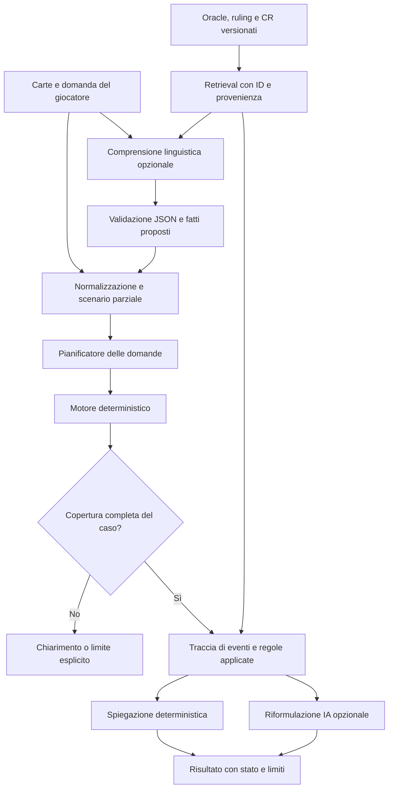

# IA ibrida per Judge Pocket — progetto, non attivazione

Data: 2026-11-13. Il rapporto segue la verifica della beta locale ristretta:
[BETA_SCOPE.md](BETA_SCOPE.md). Il motore non copre tutte le carte; l'IA non deve
nascondere questo limite. Nessun modello è stato scaricato o eseguito, nessun
servizio a pagamento o addestramento è stato attivato.

## Scelta proposta

Mantenere il percorso deterministico senza IA come predefinito. Per comprendere
frasi libere e proporre dettagli dello scenario, valutare **Qwen3-4B-Instruct-2507**
su un server controllato dal progetto. Per dispositivi realmente compatibili,
provare prima un modello molto più piccolo (Qwen3-0.6B) per estrazione di entità e
intento, senza affidargli ruling. SmolLM3-3B è l'alternativa da misurare per italiano
ed esecuzione locale; Mistral-7B-Instruct-v0.3 è un confronto lato server.

Non è una decisione d'acquisto né una dichiarazione di accuratezza Magic già
misurata. La scelta finale dipende da test su richieste italiane/inglesi e dai
vincoli reali dei dispositivi. RAG e prompting strutturato vengono prima del
fine-tuning. L'app continua a funzionare quando l'IA è disabilitata o indisponibile.

## Confronto dei modelli a pesi aperti

Memoria stimata a quantizzazione 4 bit e contesto pratico di circa 4k token.
Intervalli indicativi, non misure su questi checkpoint: formato, KV cache,
parallelismo, backend e overhead WebGPU possono modificarli sostanzialmente.

| Modello specifico | Capacità potenziale e lingue | Pesi Q4 stimati / memoria runtime | PWA e mobile | Server e manutenzione | Licenza candidata e specializzazione |
| --- | --- | --- | --- | --- | --- |
| Qwen3-4B-Instruct-2507 | Prima scelta per istruzioni strutturate; famiglia con oltre 100 lingue/dialetti dichiarati. Italiano da misurare su Magic | Circa 2,3–2,8 GB / 4–7 GB | Troppo impegnativo come requisito generale sui telefoni. Possibile su alcuni desktop/tablet potenti, dopo conversione compatibile | GPU con circa 8–12 GB VRAM per un servizio piccolo e contesto contenuto; batching e concorrenza da misurare | Apache-2.0 indicata per il checkpoint; confermare file esatto prima dell'adozione. LoRA/QLoRA possibili con tool compatibili |
| SmolLM3-3B | Candidato più leggero; il repository ufficiale dichiara inglese, francese, spagnolo, tedesco, **italiano**, portoghese. Accuratezza sulle interazioni non provata | Circa 1,8–2,3 GB / 3–5 GB | Candidato locale su dispositivi con memoria sufficiente; richiede verifica dell'architettura nel backend scelto, non basta essere una PWA | GPU da circa 8 GB per esperimenti piccoli; CPU possibile con latenza maggiore | Apache-2.0 candidata; licenza del repository consultata, file del checkpoint ancora da confermare. LoRA/QLoRA da validare nel framework scelto |
| Mistral-7B-Instruct-v0.3 | Confronto server con più parametri; nessuna garanzia che superi modelli più recenti su italiano o Magic. Inglese generalmente più favorevole | Circa 4–5 GB / 6–10 GB | Inadatto come download predefinito sui telefoni. WebLLM documenta la famiglia Mistral-7B-v0.3, ma questo non garantisce esecuzione su iOS | GPU da circa 12–16 GB per contesto/concorrenza limitati; CPU lenta, maggiori costi rispetto ai piccoli modelli | Apache-2.0 candidata; separare licenza del runtime da quella dei pesi. LoRA/QLoRA supportati dall'ecosistema, da verificare sulla versione |
| Qwen3-0.6B, opzione locale | Estrattore leggero di nomi, intenzione e campi JSON. Maggiore rischio di errori: nessuna decisione sulle regole | Circa 0,4–0,6 GB / 1–2 GB | Più realistico per una prova opt-in, ma non universale: WebGPU, memoria di tab e backend restano prerequisiti | Può evitare alcune chiamate al server; non sostituisce il modello server per richieste difficili | Verificare licenza e artefatto convertito esatti. Nessun fine-tuning previsto inizialmente |

Per parametri P e pesi puramente a 4 bit il limite teorico è P × 0,5 byte: per
4 miliardi di parametri sono 2 GB decimali prima di scale, metadati, runtime e
KV cache. Non confondere dimensione del file, RAM totale del dispositivo e memoria
realmente allocabile dal browser. Le stime non valgono per download FP16.

### Licenze e fonti effettivamente consultate

Consultati via HTTPS, solo testi di documentazione (nessun file di pesi):

- [Qwen3, repository ufficiale](https://github.com/QwenLM/Qwen3): dimensioni,
  supporto multilingue e release 4B Instruct-2507.
- [SmolLM, repository ufficiale](https://github.com/huggingface/smollm): SmolLM3,
  dimensione 3B e lingue supportate. Il file LICENSE del repository è Apache-2.0.
- [Mistral inference](https://github.com/mistralai/mistral-inference): checkpoint
  Mistral-7B-Instruct-v0.3 e runtime. LICENSE del codice: Apache-2.0.
- [WebLLM](https://github.com/mlc-ai/web-llm): esecuzione WebGPU e formati/backend
  supportati. Un modello Hugging Face non diventa automaticamente eseguibile in
  WebLLM: servono pesi convertiti e la libreria compilata per quell'architettura.
- [Microsoft Phi cookbook](https://github.com/microsoft/Phi-3CookBook): ulteriore
  riferimento per ONNX Runtime Web/WebGPU; non è un benchmark comparativo eseguito.

Le richieste alle tre model card ufficiali Hugging Face sono state bloccate dal
proxy (CONNECT 403). Quindi **la verifica del testo della licenza dei pesi esatti
non è conclusa**: le indicazioni in tabella sono candidature, non autorizzazione
legale già verificata. La licenza del repository software non prova da sola quella
del checkpoint. Prima di distribuire pesi, recuperare i file esatti e verificare
uso commerciale, redistribuzione, attribuzioni/NOTICE, artefatti quantizzati e
termini dei dati. Non modificare la rete o scaricare pesi automaticamente.

Model card da verificare:
[Qwen3-4B-Instruct-2507](https://huggingface.co/Qwen/Qwen3-4B-Instruct-2507),
[SmolLM3-3B](https://huggingface.co/HuggingFaceTB/SmolLM3-3B),
[Mistral-7B-Instruct-v0.3](https://huggingface.co/mistralai/Mistral-7B-Instruct-v0.3).

Apache-2.0, se effettivamente applicabile all'artefatto distribuito, consente uso
commerciale con gli obblighi previsti; non implica proprietà dei marchi o una
licenza universale sui dati delle carte. Non presumere che una licenza si applichi
indifferentemente a tutta la famiglia di un modello.

## Flusso e confini dell'architettura

Il modello propone un JSON limitato: carte/Oracle ID, evento, fatti espliciti,
fatti mancanti, lingua. Niente JavaScript eseguibile, patch del repository o
chiamate arbitrarie. Il validatore rifiuta campi e valori fuori schema. I fatti
non forniti restano sconosciuti, anche se il modello li considera plausibili.
Un'eventuale proposta ambigua viene confermata dal giocatore.

Il planner interroga soltanto il motore deterministico: mai un LLM come
`scenarioEvaluator`. Le risposte del modello non possono trasformare un risultato
`partial` o `unsupported` in `verified`, aggiungere prove di provenienza o inventare
citazioni. Se il motore non sa calcolare un'interazione, più contesto RAG o un
modello più grande non autorizzano un ruling.

La spiegazione primaria resta quella ricostruita dagli eventi e dalle regole.
La riformulazione IA viene indicata come assistenza opzionale. Una semplice regex
non può provare l'equivalenza semantica di un testo libero: prima di promuovere
una riformulazione come spiegazione normativa occorre un controllo più forte;
nel frattempo la traccia deterministica resta sempre visibile.

## RAG prima del fine-tuning

1. **Oracle**: indicizzare per Oracle ID e nome, con testi integrali, facce,
   caratteristiche, hash e versione dello snapshot. La beta ha già lookup e
   shard locali: riutilizzarli invece di creare un secondo database divergente.
2. **Ruling**: Oracle ID, data, fonte dichiarata, testo. Recuperare solo quelli
   pertinenti. Non inferire che un ruling su una carta risolva tutta la coppia.
3. **Comprehensive Rules**: chunk per regola/sottoregola, intestazioni e rimandi;
   edizione, provenienza, digest, stato di autenticazione e copertura obbligatori.
   Il blocco sulle fonti già presente non viene aggirato dal retrieval.
4. **Primo retrieval**: lookup esatto + ricerca lessicale/BM25 e tag deterministici
   delle meccaniche. Le regole già applicate dal motore hanno precedenza. Questo
   non richiede un modello embedding o una GPU.
5. **Embedding opzionali**: solo se una valutazione mostra un vantaggio misurabile
   sul retrieval italiano/inglese. Verificare separatamente modello, licenza,
   memoria e aggiornamenti prima di aggiungerli.
6. **Prompt**: contesto minimo, ID delle fonti, JSON schema, esempi di astensione e
   divieto di inferire fatti assenti. Testi Oracle, ruling e input utente sono
   dati non attendibili come istruzioni; evitare prompt injection.

Cache delle spiegazioni e dei retrieval per firma dello scenario, versione del
motore, edizione CR e hash Oracle. Una modifica di regole o carte deve invalidare
le cache interessate. Le cache di modello sono separate dalla cache PWA del
motore e non devono impedirne l'avvio.

## Locale, server e ibrido

- **Locale**: download opzionale solo dopo consenso dell'utente, feature detection
  WebGPU, quota storage e budget memoria; processo in Web Worker, annullamento,
  limite contesto/token e possibilità di eliminare i pesi. Su browser non adatti
  resta l'interfaccia deterministica. Non promettere supporto uniforme Android/iOS.
- **Server proprietario**: modelli aperti con llama.cpp oppure altro runtime
  compatibile; API limitata a comprensione/spiegazione, code, rate limit, timeout,
  cancellazione e metriche. Nessun endpoint per eseguire codice del modello.
  I costi sono hardware, energia/hosting e manutenzione, anche senza tariffazione
  commerciale per token.
- **Ibrido**: motore e dati base sul dispositivo; piccolo modello locale sui
  dispositivi compatibili; server solo per assistenza richiesta e non gestibile
  localmente. La presenza di un fallback server richiede una scelta di privacy
  chiara. Non inviare foto o stato di partita automaticamente.

## Stima economica per 100, 1.000 e 10.000 utenti attivi

**Ipotesi illustrative, non preventivi di fornitori né benchmark eseguiti. Importi in euro, imposte escluse.**
“Utenti attivi” significa utenti mensili. Servono anche intensità d'uso e picchi:
il numero di utenti da solo non dimensiona un'infrastruttura.

Ipotesi base:

- 20 interazioni per utente/mese; il 30% richiede assistenza linguistica.
- 1.000 token di input recuperato e 200 di output per richiesta assistita.
- 10 secondi di servizio GPU per richiesta, compreso prefill: ipotesi da misurare.
- Una GPU sempre accesa: 300 €/mese; API/index/monitoraggio: 20 €/mese;
  hosting statico/base CDN: 10 €/mese. Nessun prezzo live è stato verificato.
- 720 ore/mese, utilizzo obiettivo 50% per margine: capacità teorica di 129.600
  richieste assistite/mese/GPU. Non garantisce una latenza ai picchi.
- Nel modello ibrido il 60% delle richieste assistite è gestibile localmente.
- Modello locale leggero: 0,5 GB da scaricare una volta per utente compatibile
  nel mese considerato, traffico ipotizzato a 0,02 €/GB. Non sono pesi scaricati
  per questo lavoro e non è il modello server 4B.

| Utenti/mese | Interazioni totali | Richieste assistite | Richieste al server ibrido | Solo locale, infrastruttura €/mese | Solo server, infrastruttura €/mese | Ibrido, infrastruttura €/mese |
| ---: | ---: | ---: | ---: | ---: | ---: | ---: |
| 100 | 2.000 | 600 | 240 | 11 | 330 | 330,60 |
| 1.000 | 20.000 | 6.000 | 2.400 | 20 | 330 | 336 |
| 10.000 | 200.000 | 60.000 | 24.000 | 110 | 330 | 390 |

Calcoli riproducibili: `python3 scripts/estimate-ai-costs.py`.
Il caso “solo locale” presuppone dispositivi compatibili per tutte le richieste:
non offre la stessa copertura del server e trasferisce consumo di RAM, batteria,
spazio e traffico al giocatore. Non è gratuito per il dispositivo dell'utente.

A questi volumi ipotetici il server resta una GPU in entrambi i casi: **l'ibrido
riduce il carico ma non riduce automaticamente il canone fisso**; la distribuzione
dei pesi può farlo costare più del solo server. Non giustificare l'ibrido con
risparmi che il modello non mostra.

Sensibilità: se il 100% delle 200.000 interazioni a 10.000 utenti richiedesse IA,
il modello di capacità richiederebbe due GPU per il solo server: circa 630 €/mese;
con 60% locale resterebbero 80.000 richieste server e una GPU, circa 390 €/mese.
Se invece il tempo per richiesta raddoppia, la capacità si dimezza. Picchi,
accodamento, concorrenza e obiettivo di latenza possono richiedere più nodi anche
quando il conteggio mensile sembra sufficiente.

### Iniziali, fissi, variabili e manutenzione

| Categoria | Cosa include | Stima di pianificazione, senza acquisti |
| --- | --- | --- |
| Sviluppo iniziale RAG/adapter/eval | Integrazione, dataset di verifica, schema, privacy e fallback | 40–120 ore; a un valore ipotetico di 50 €/h, 2.000–6.000 €. È valorizzazione del lavoro, non spesa autorizzata |
| Hardware proprio, alternativa al noleggio | GPU/macchina, memoria e storage adatti | Ordine di grandezza 1.500–3.000 € iniziali, da quotare; ammortamento a 36 mesi circa 42–83 €/mese |
| Energia hardware proprio | Esempio di 60–180 W medi per 720 ore | 43–130 kWh/mese; a 0,30 €/kWh, circa 13–39 €/mese, oltre a rete e manutenzione |
| Fissi cloud | GPU riservata, API e monitoraggio | Ipotesi della tabella: 330 €/mese con una GPU e hosting statico incluso |
| Variabili | Banda pesi/risposte, log, backup, eventuali nodi extra | Dipendono da aggiornamenti dei modelli, quota cache-hit e carico; prezzi della tabella solo esemplificativi |
| Manutenzione | Patch, incidenti, licenze, aggiornamenti CR/Oracle/modelli, regressioni | 2–8 ore/mese; a 50 €/h, 100–400 €/mese di lavoro, esclusi dalla tabella infrastrutturale |

Nessun risparmio derivante da quantizzazione, batching, autoscaling o CPU viene
considerato acquisito senza benchmark. Un server casalingo ha costi e rischi di
continuità/connessione; non è equivalente a un servizio con SLA.

## LoRA/QLoRA e roadmap verificabile

1. **Congelare una baseline**: motore/UI senza IA, casi supportati e casi in cui
   deve astenersi, inclusi contraddizioni, fatti mancanti e fonti obsolete.
2. **Dataset di valutazione**: almeno 200 richieste italiane/inglesi con nomi
   ambigui, scenari minimi e domande superflue. Separare train/dev/test, evitare
   che la stessa famiglia di scenario compaia in modo identico nei tre insiemi.
3. **RAG + JSON schema**: misurare richiamo delle fonti, estrazione dei fatti,
   tasso di astensione corretta e nessuna promozione indebita di unsupported.
4. **Confronto locale/server**: prima con pochi dispositivi disponibili e un
   hardware già autorizzato. Misurare token/s, memoria, latenza p50/p95,
   stabilità termica, download e consumo, senza inventare risultati.
5. **Pilota opt-in**: piccolo campione, quote e privacy esplicite. Il modello
   non deve impedire l'uso del motore o l'avvio della PWA.
6. **Solo se necessario, LoRA/QLoRA**: migliorare formato/italiano/estrazione,
   non memorizzare ruling di coppie. Per piccoli modelli, una GPU 16–24 GB può
   essere un punto di partenza per QLoRA, non una garanzia: sequenza, batch e
   ottimizzatore determinano il fabbisogno. Stimare dopo un piccolo dry-run
   autorizzato; nessun noleggio o training viene avviato ora.
7. **Gate di rilascio**: regressioni deterministiche intatte, nessuna decisione
   normativa del modello, provenienza verificata delle fonti secondo la politica
   del progetto, benchmark linguistici e controllo della licenza del checkpoint.

Un fine-tuning non aggiorna automaticamente le regole quando cambia un'edizione;
per questo RAG versionato e il motore rimangono la base anche dopo eventuali LoRA.
